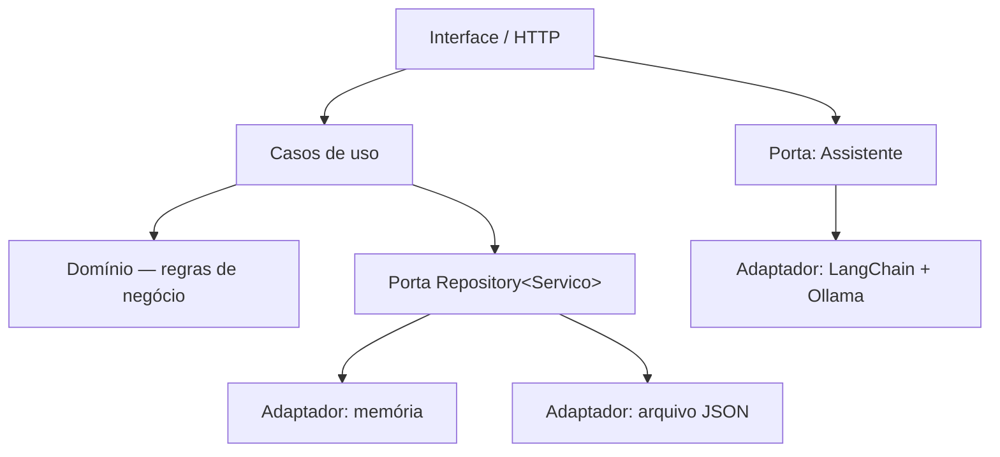

<div align="center">

# 🏗️ ARCHLAB
### Laboratório de Arquitetura de Software com TypeScript + IA Local

**Projeto prático de conclusão da etapa de Arquitetura de Software · Pós-Tech Full Stack Development**

**POO · Interfaces · Generics · IoC/DI · SOLID · Hexagonal · Onion · Clean Architecture · LangChain · Ollama**

[🚀 Começar](#-começando-do-zero) · [🤖 IA local](#-diferencial-uma-ia-rodando-no-seu-computador) · [📘 Aulas](docs/GUIA_DE_ESTUDOS.md) · [🧱 Arquitetura](docs/ARQUITETURA_EXPLICADA.md)

</div>

---

> 🤖 **O diferencial:** no final deste laboratório você poderá **conversar com uma inteligência artificial que roda no próprio computador**, com **Llama 3.2, Ollama e LangChain**. Não é necessário pagar por uma API nem ter conta em um serviço de IA. A primeira instalação e o download do modelo exigem internet; depois, a inferência pode funcionar **offline**.

## 🎯 O que você vai construir

O ArchLab é uma aplicação didática com dados **fictícios** de serviços de engenharia. A interface permite cadastrar serviços, registrar medições, visualizar avanço físico e financeiro e experimentar a troca de armazenamento **Memória ↔ JSON**.

A ideia principal é entender que um sistema organizado não deve precisar de novas regras de negócio quando trocamos apenas a tecnologia de armazenamento.

**Funções para testar:**
- Painel de serviços, valores contratados e avanço físico ponderado.
- Cadastro, medição, exclusão e restauração de dados de exemplo.
- Troca de adaptadores sem mudar os casos de uso.
- Visualização de Hexagonal, Onion e Clean Architecture.
- Rastreamento didático da requisição pelas camadas.
- Assistente de IA local que recebe os dados fictícios do sistema.
- Nove testes automatizados.

## 📚 Oito aulas, uma aplicação

| Aula | Tema estudado | Arquivo para explorar |
|:--:|---|---|
| 01 | POO, classes, encapsulamento, herança, polimorfismo | `src/domain/Servico.ts` |
| 02 | Interfaces e Generics | `src/ports/Repository.ts` |
| 03 | Inversão de Controle e Injeção de Dependência | `src/composition/container.ts` |
| 04 | SOLID e separação de responsabilidades | `src/application/use-cases/Servicos.ts` |
| 05 | Hexagonal / Ports and Adapters | `src/ports/` e `src/infrastructure/` |
| 06 | Onion Architecture e direção das dependências | `src/domain/` |
| 07 | Clean Architecture e casos de uso | `src/application/use-cases/` |
| 08 | TypeScript com IA: LangChain + Ollama | `src/infrastructure/ai/OllamaLangChain.ts` |

Hexagonal, Onion e Clean são **perspectivas complementares** demonstradas na mesma aplicação — não três projetos independentes.

## 🚀 Começando do zero

### Pré-requisitos

- Node.js **20+** e npm instalados.
- VS Code (ou outro editor).
- Git, caso queira clonar pelo terminal.

Clone o projeto:

```bash
git clone https://github.com/lionzionion/archlab-typescript-software-architecture.git
cd archlab-typescript-software-architecture
npm install
npm run build
npm start
```

Abra **http://localhost:5500** no navegador.

**Windows:** também pode executar `INICIAR_ARCHLAB.bat` dentro da pasta clonada. Ele instala dependências na primeira execução, compila e inicia o servidor. **Abra o navegador manualmente:** o BAT não tenta iniciá-lo automaticamente.

> ⚠️ Execute os comandos **na pasta do `package.json`**. Se aparecer ENOENT ou *Missing script*, verifique o diretório atual antes de reinstalar qualquer coisa.

### Testes automatizados

```bash
npm run typecheck
npm test
```

Os testes não precisam da IA local. A execução de `npm test` compila o TypeScript e roda os nove testes de arquitetura/domínio. O workflow de CI repete a verificação a cada atualização.

## 🤖 Diferencial: uma IA rodando no seu computador!

Este é o **bônus mais legal para quem chegar à Aula 08**: uma integração real entre TypeScript, LangChain e um modelo de linguagem que roda localmente no Ollama.

1. Instale o [Ollama](https://ollama.com/download).
2. Baixe o modelo: `ollama pull llama3.2`.
3. Confirme que responde: `ollama run llama3.2` (saia do chat com `/bye`).
4. Mantenha o Ollama ativo na porta local `11434`.
5. Na pasta do projeto, execute `npm install`, `npm run build` e `npm run check:ai`.
6. Inicie `npm start`; abra **http://localhost:5500** → **IA local**.

**Pergunta de exemplo:**
> Com base somente nos dados fictícios cadastrados no ArchLab, quais serviços têm menor avanço físico? Não invente valores.

O modelo não vem dentro do repositório. A IA **não é uma API online e não é uma resposta simulada**; é uma chamada do back-end para o Ollama na máquina do usuário. A instalação inicial de pacotes e do modelo exige internet. As respostas podem conter erros e devem ser conferidas.

**Se a IA falhar:** veja [Solução de problemas](docs/SOLUCAO_DE_PROBLEMAS.md). O restante do sistema continua funcionando sem Ollama.

## 🧱 Como o código se organiza



```text
src/
├── domain/                    Entidades e validações
├── ports/                     Interfaces e contratos
├── application/use-cases/     Operações do negócio
├── infrastructure/            JSON, memória e IA local
├── composition/               Injeção de dependências
└── server.ts                  Adaptador HTTP / API

public/                        Interface HTML, CSS e JavaScript
tests/                         Testes de arquitetura
docs/                          Guias e material didático
scripts/                       Diagnóstico do Ollama
```

As **regras do domínio não dependem do framework, do navegador, do arquivo JSON ou do Ollama**. Veja [a explicação de arquitetura](docs/ARQUITETURA_EXPLICADA.md).

## 🧪 Exercícios para quem clonar

1. Cadastre um serviço e verifique o valor calculado.
2. Tente lançar **105% de avanço**. Descubra qual classe bloqueia o valor inválido.
3. Troque o armazenamento de memória para JSON e observe que as regras continuam iguais.
4. Abra `src/composition/container.ts` e identifique a injeção de dependência.
5. Rode `npm test`.
6. **Bônus:** instale o Ollama e faça uma pergunta com os dados da simulação.

Confira os desafios de cada aula em [GUIA_DE_ESTUDOS.md](docs/GUIA_DE_ESTUDOS.md).

## ⚠️ Observações

- Projeto **educacional**, não destinado à gestão real de obras; não possui autenticação, permissões ou controle multiusuário.
- As informações de engenharia são inteiramente **fictícias**.
- O servidor escuta apenas em `127.0.0.1` (uso local).
- O arquivo `data/servicos.json` é criado em tempo de execução e não é versionado.
- Não inclua dados pessoais, documentos sigilosos ou modelos de IA baixados nos commits.
- Os PDFs das apostilas da instituição **não são distribuídos** aqui. O material documentado é uma aplicação prática autoral dos conceitos.

## 🤝 Para os colegas da Pós-Tech

Clonem, modifiquem, quebrem, testem, comparem implementações e compartilhem suas melhorias. O objetivo é realmente aprender a **pensar a arquitetura**, e não apenas copiar uma pasta pronta.

📣 [Mensagem para o grupo/Discord](docs/MENSAGEM_COLEGAS.md) · [Roteiro para o LinkedIn](docs/ROTEIRO_LINKEDIN.md)

Licença: [MIT](LICENSE).
